# ReMix RF Localization — Experiment Report

## Table of Contents

1. [Experimental Setup](#1-experimental-setup)
2. [Algorithms](#2-algorithms)
3. [Experiment 1: Baseline Performance Comparison](#3-experiment-1-baseline-performance-comparison)
4. [Experiment 2: Frequency Pair Optimization](#4-experiment-2-frequency-pair-optimization)
5. [Experiment 3: Y-Axis Failure Analysis](#5-experiment-3-y-axis-failure-analysis)
6. [Experiment 4: Signal Quality & Attenuation Analysis](#6-experiment-4-signal-quality--attenuation-analysis)
7. [Experiment 5: Tissue Model Effectiveness](#7-experiment-5-tissue-model-effectiveness)
8. [Experiment 6: Algorithmic Improvements](#8-experiment-6-algorithmic-improvements)
9. [Summary](#9-summary)

---

## 1. Experimental Setup

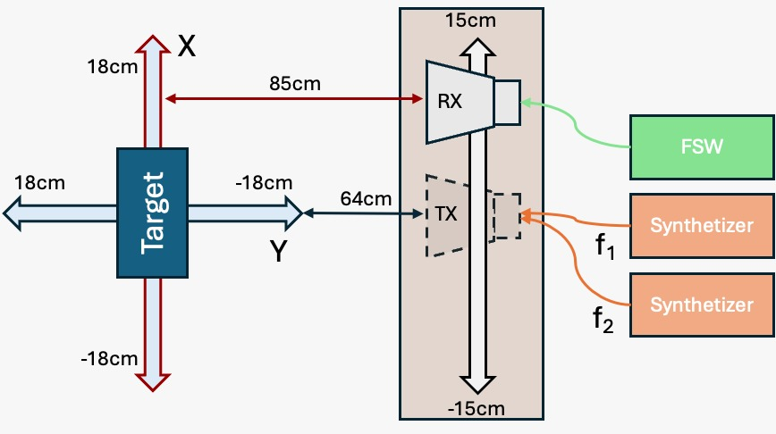

- **Environment:** Anechoic chamber
- **Transmitter (Tx):** Static antenna at position (0, 400) mm
- **Receiver (Rx):** 5-element linear array at positions -150, -75, 0, +75, +150 mm (all at y = 0)
- **Target:** Diode/patch antenna mounted on a motorized linear stage
- **Scan range:** -180 mm to +180 mm along both lateral (X) and depth (Y) axes
- **Frequencies:** 7 harmonics — 790, 910, 1620, 1660, 1700, 1740, 1780 MHz
- **Samples per point:** 1001 temporal IQ samples, coherently averaged

### Tissue Conditions

| Condition | Description | Approximate Thickness |
|-----------|-------------|:---------------------:|
| **Patch** | Free-space (bare antenna, no tissue) | 0 mm |
| **Chicken** | Chicken breast placed over the target antenna | ~5 mm |
| **Pork** | Pork meat placed over the target antenna | ~10 mm |

---

## 2. Algorithms

### 2.1 Harmonic Combination (HC)

From the original ReMix paper (Eq. 14). Uses the phase difference between two specific harmonics to create a virtual low-frequency signal with a wider unambiguous range. Default pair: 790 MHz + 1700 MHz. Single-step grid search over target positions using the combined phase.

### 2.2 Calibrated Phase Matching

Uses all 7 frequencies simultaneously. A calibration measurement at position 0 mm serves as the phase reference. For each candidate target position, the algorithm computes the expected differential phase change across all antennas and frequencies, and finds the position that minimizes the complex residual.

Two-stage approach:
1. **Coarse:** Uses the two lowest frequencies (790, 910 MHz) to identify candidate positions with long unambiguous range.
2. **Fine:** Uses all 7 frequencies around the best coarse candidate for sub-mm refinement.

---

## 3. Experiment 1: Baseline Performance Comparison

**Goal:** Compare Harmonic Combination vs. Calibrated localization across all 6 conditions (3 tissues x 2 axes).

### Median Error Comparison

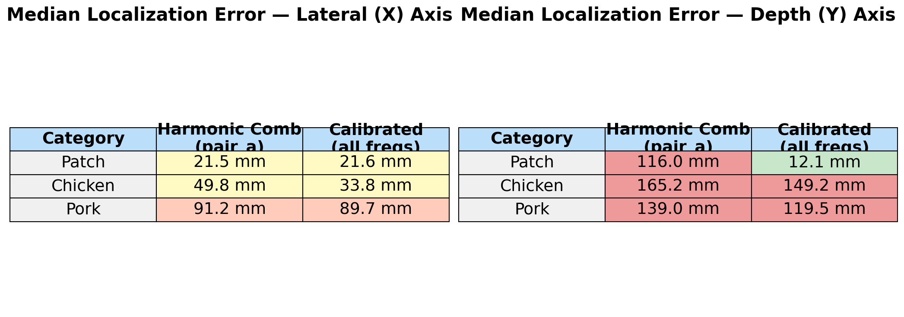

| Condition | HC (790, 1700) | Calibrated (all 7 freqs) |
|-----------|:--------------:|:------------------------:|
| **Patch/X** | 22.8 mm | 21.6 mm |
| **Chicken/X** | 20.2 mm | 45.2 mm |
| **Pork/X** | 94.2 mm | 89.9 mm |
| **Patch/Y** | 116.0 mm | 14.6 mm |
| **Chicken/Y** | 178.2 mm | 144.8 mm |
| **Pork/Y** | 114.0 mm | 115.8 mm |

Observations:
- For the **X-axis** (lateral), HC is competitive or better, likely because the strong 1700 MHz harmonic dominates the estimate.
- For the **Y-axis** (depth), the calibrated approach achieves significantly lower error for Patch, but both algorithms perform poorly for Chicken and Pork.
- **Chicken/X** is a notable result: HC outperforms the 7-frequency calibrated approach by 2.2x. This suggests that the additional frequencies (which have poor SNR through chicken tissue) add noise rather than information.

### Error Distributions

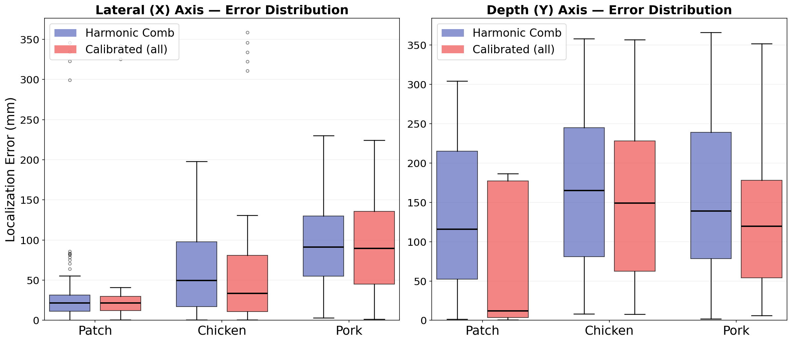

Detailed per-axis breakdowns:

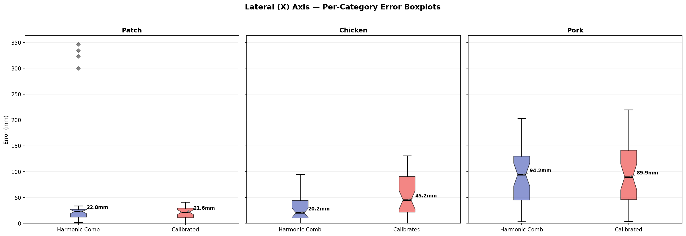

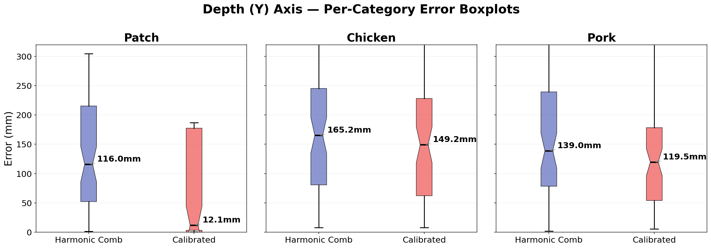

The Patch/Y calibrated distribution is bimodal: approximately 50% of points have near-perfect accuracy (<15 mm) while approximately 40% have large errors (>170 mm) due to mirror ambiguity (analyzed in Experiment 3).

---

## 4. Experiment 2: Frequency Pair Optimization

**Goal:** Determine whether the original paper's frequency pair (790, 1700 MHz) is optimal for the harmonic combination algorithm.

**Method:** Tested all C(7,2) = 21 possible frequency pairs across all 6 conditions.

### Heatmaps

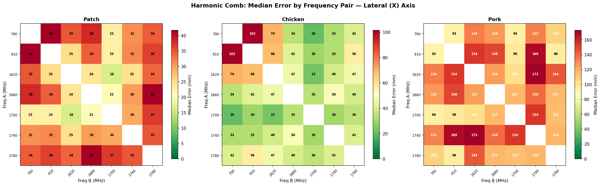

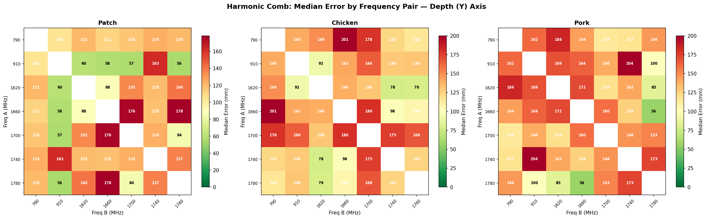

### Rankings

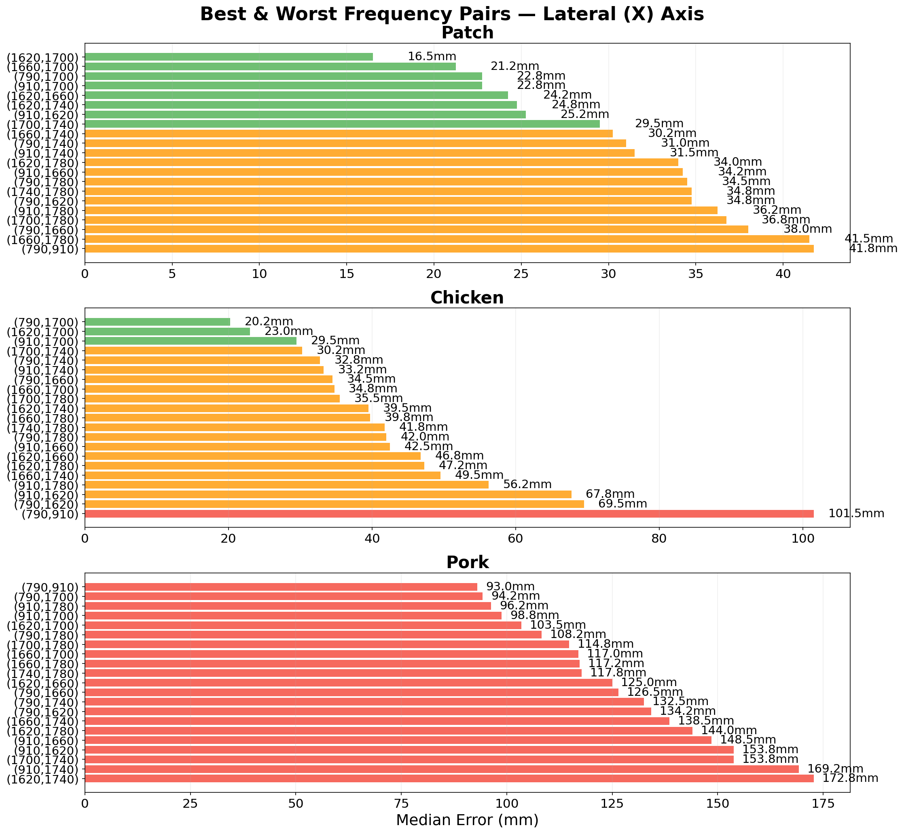

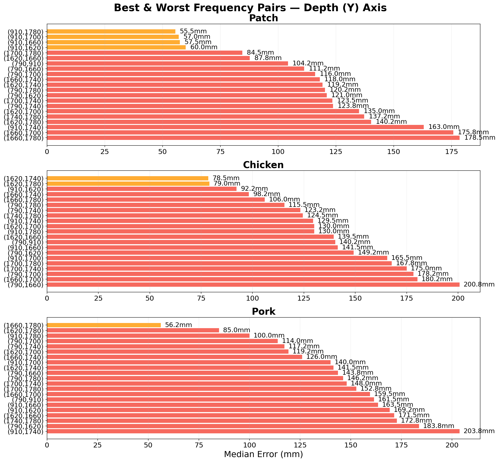

### Best Pair Per Condition

| Condition | Best Pair | Best Median | Original (790, 1700) | Improvement |
|-----------|:---------:|:-----------:|:--------------------:|:-----------:|
| Patch/X | (1620, 1700) | 16.5 mm | 22.8 mm | -6.3 mm (28%) |
| Chicken/X | (790, 1700) | 20.2 mm | 20.2 mm | -- (already best) |
| Pork/X | (790, 910) | 93.0 mm | 94.2 mm | -1.2 mm (1%) |
| Patch/Y | (910, 1780) | 55.5 mm | 116.0 mm | -60.5 mm (52%) |
| Chicken/Y | (1620, 1740) | 78.5 mm | 178.2 mm | -99.7 mm (56%) |
| Pork/Y | (1660, 1780) | 56.2 mm | 114.0 mm | -57.8 mm (51%) |

Findings:
- The paper's default pair (790, 1700) is optimal in only 1 out of 6 conditions (Chicken/X).
- Y-axis improvements are substantial: the right pair can reduce error by over 50%.
- Optimal pairs are tissue-dependent. For X-axis, 1700 MHz appears in most top pairs (strongest harmonic). For Y-axis, closely-spaced high-frequency pairs perform better.
- Full data available in [`results/freq_pair_comparison.csv`](results/freq_pair_comparison.csv).

---

## 5. Experiment 3: Y-Axis Failure Analysis

**Goal:** Understand why Y-axis localization fails for many positions, even in free-space (Patch).

### Cost Landscape Visualization

We visualized the phase-cost function across the entire Y-axis search range for every target position.

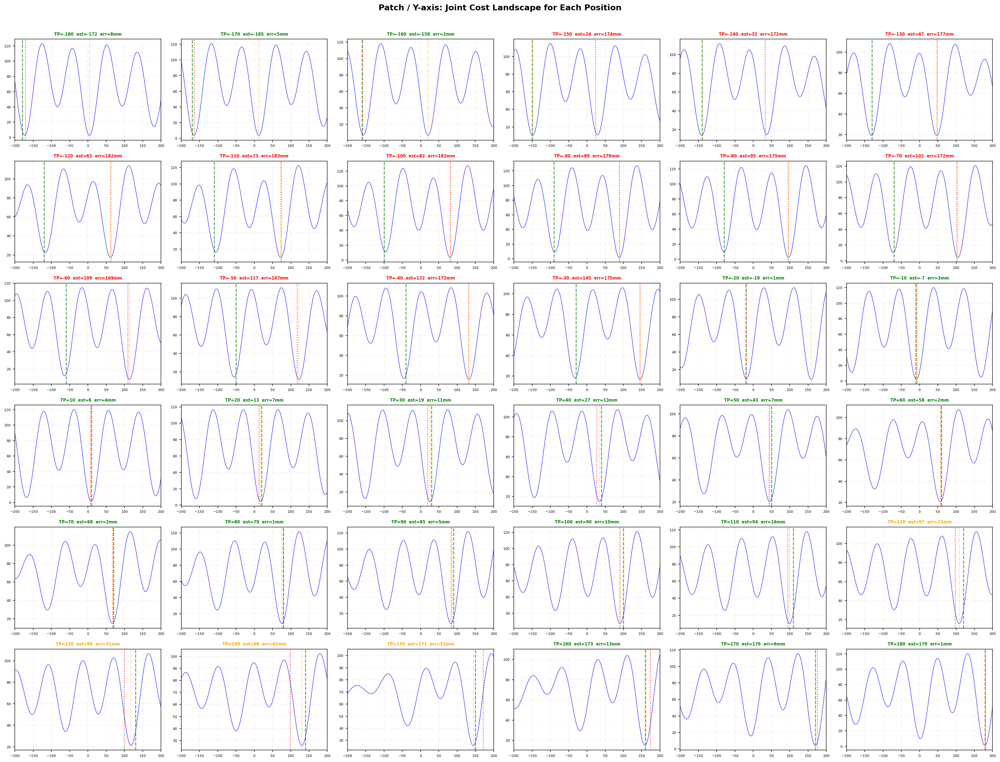

**Root cause: mirror ambiguity.** The cost landscape exhibits 4-5 periodic local minima spaced approximately 85 mm apart (about half the wavelength at 1700 MHz). For negative target positions, the optimizer systematically selects a mirror minimum located at approximately +|TP|.

### Phase Wrapping Analysis

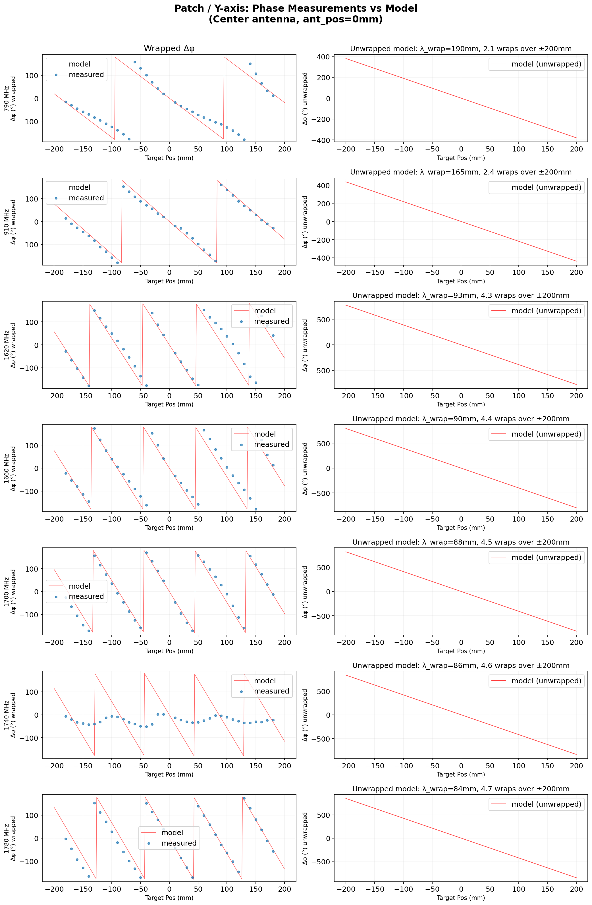

### Coarse vs. Fine Stage

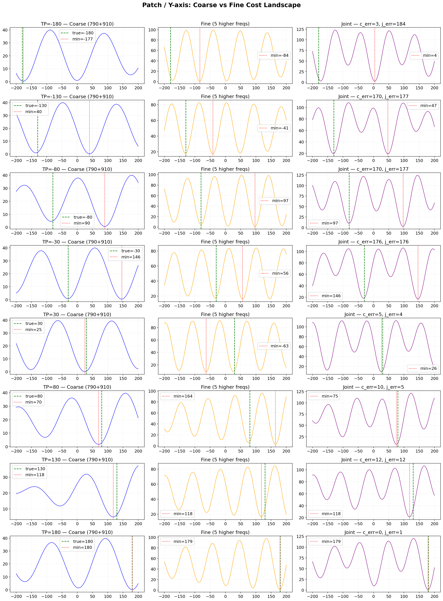

Why the hierarchical approach fails on Y:
1. The coarse stage (790 + 910 MHz) correctly identifies a single broad basin.
2. However, the coarse minimum is sometimes displaced by 30-50 mm from the true position.
3. The fine-stage refinement window then captures the wrong high-frequency minimum.

### Cost Landscapes for Tissue Conditions

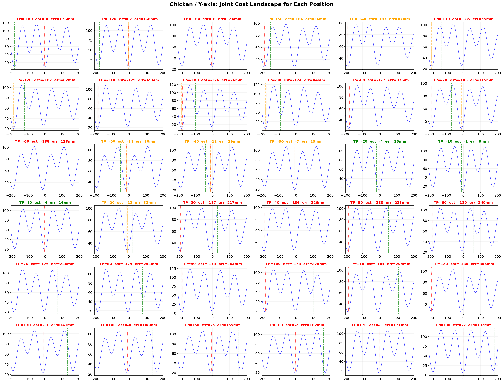

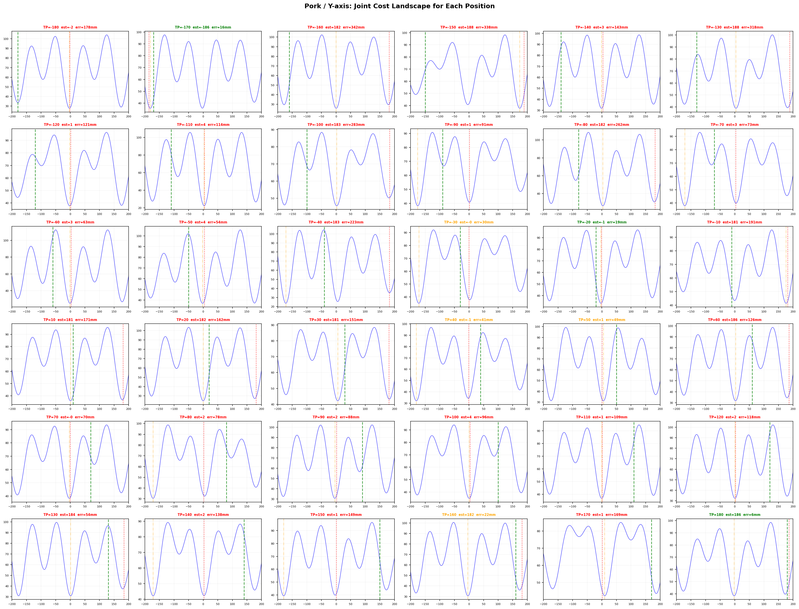

For Chicken and Pork, the cost landscape has no clear structure. The minima are randomly distributed, consistent with phase measurements being noise-dominated (see Experiment 4).

---

## 6. Experiment 4: Signal Quality & Attenuation Analysis

**Goal:** Determine whether the poor performance on tissue-covered samples is due to signal attenuation (hardware/physics limitation) or algorithmic shortcomings.

### 6.1 Received Power Levels

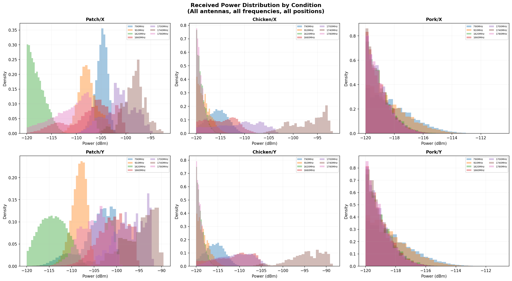

| Condition | 790 MHz (dBm) | 1700 MHz (dBm) | Margin above noise floor (-120 dBm) |
|-----------|:---:|:---:|:---:|
| **Patch/X** | -105.0 | -101.3 | 15-19 dB |
| **Patch/Y** | -104.7 | -97.1 | 15-23 dB |
| **Chicken/X** | -115.6 | -111.3 | 4-9 dB |
| **Chicken/Y** | -115.6 | -111.0 | 4-9 dB |
| **Pork/X** | -118.1 | -119.0 | 1-2 dB |
| **Pork/Y** | -118.1 | -119.0 | 1-2 dB |

Pork signal power is only 1-2 dB above the instrument noise floor of -120 dBm.

### 6.2 Power vs Target Position

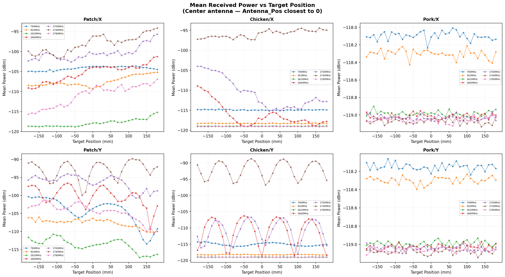

- **Patch:** Clear position-dependent power variation (~20 dB dynamic range across frequencies), confirming a strong, coherent backscatter signal.
- **Chicken:** The 1700 MHz harmonic shows some position dependence, but 790 MHz and lower harmonics are nearly flat at -120 dBm.
- **Pork:** Completely flat at -118 to -119 dBm across all positions and all frequencies. No position-dependent variation is observed.

### 6.3 Tissue Attenuation

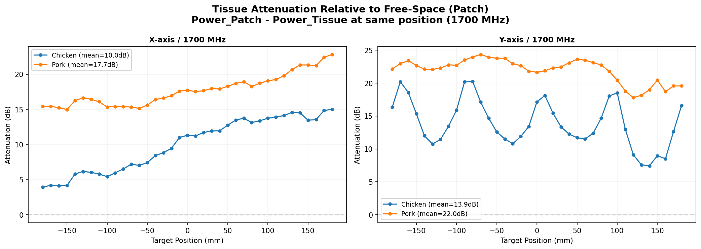

| Tissue | X-axis Attenuation (dB) | Y-axis Attenuation (dB) |
|--------|:---:|:---:|
| **Chicken** | 4-15 dB (mean: 10.0 dB) | 7-20 dB (mean: 13.9 dB) |
| **Pork** | 15-23 dB (mean: 17.7 dB) | 17-24 dB (mean: 22.0 dB) |

Pork introduces 17-22 dB of round-trip attenuation at 1700 MHz.

### 6.4 Phase Stability

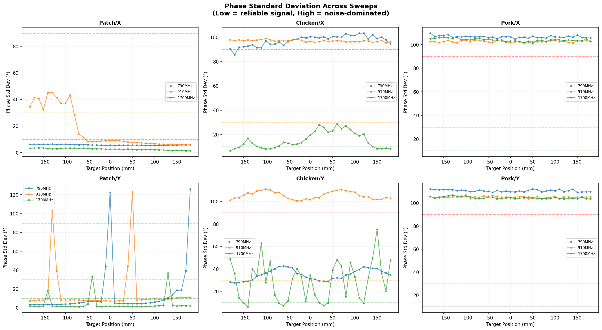

Phase standard deviation across repeated sweeps measures signal coherence:

| Condition | 790 MHz Phase Std | 1700 MHz Phase Std | Interpretation |
|-----------|:---:|:---:|---|
| **Patch/X** | 5-8 deg | 2-5 deg | Coherent signal |
| **Chicken/X** | 85-100 deg | 5-15 deg | 1700 MHz usable; 790 MHz is noise |
| **Pork/X** | 100-110 deg | 100-110 deg | All frequencies are noise |
| **Patch/Y** | 5-8 deg | 2-5 deg | Coherent signal |
| **Chicken/Y** | 30-50 deg | 5-15 deg | 1700 MHz partially usable |
| **Pork/Y** | 105-115 deg | 105-115 deg | All frequencies are noise |

A uniform random phase distribution has a standard deviation of 104 deg. Pork measurements at all frequencies exceed this threshold, indicating the phase values contain no position-dependent information.

### 6.5 Phase Model Residual

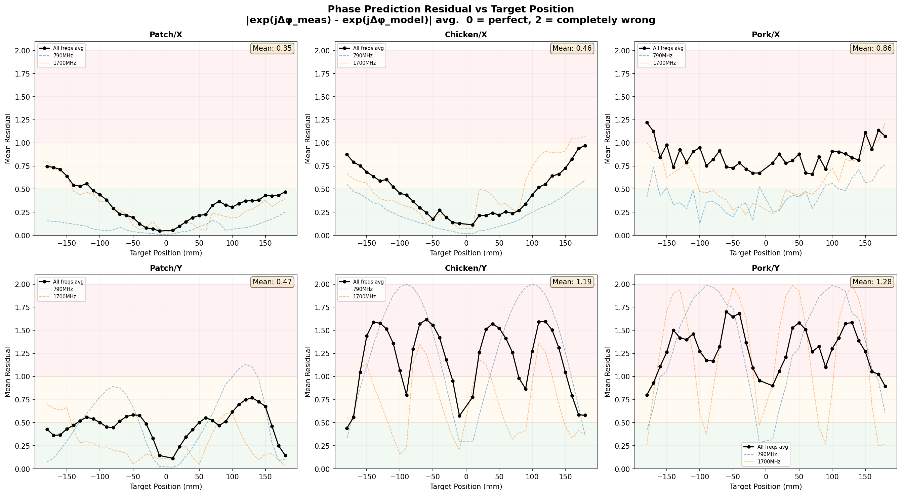

The complex residual |exp(j * delta_phi_meas) - exp(j * delta_phi_model)| measures how well the geometric model predicts the observed phase. Scale: 0 = perfect match, 2 = worst possible.

| Condition | Mean Residual |
|-----------|:---:|
| **Patch/X** | 0.35 |
| **Chicken/X** | 0.46 |
| **Pork/X** | 0.86 |
| **Patch/Y** | 0.47 |
| **Chicken/Y** | 1.19 |
| **Pork/Y** | 1.28 |

### 6.6 Power-Error Correlation

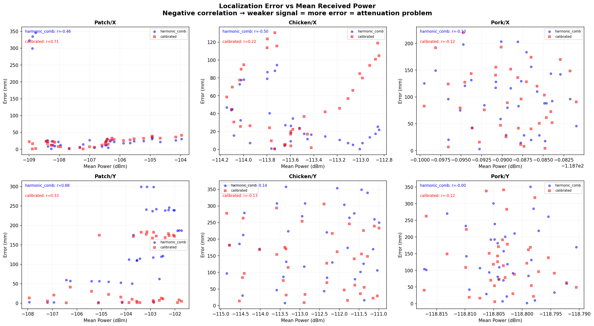

- For Pork, the correlation r is approximately 0 because all power readings are clustered at the noise floor.
- For Chicken/X (HC), r = -0.50, confirming a relationship between weaker signal and larger error.

### 6.7 Condition-by-Condition Diagnosis

| Condition | Mean Power | Phase Std | Residual | Primary Bottleneck |
|-----------|:---:|:---:|:---:|---|
| Patch/X | -107 dBm | ~8 deg | 0.35 | Algorithm (Y-axis: mirror ambiguity) |
| Chicken/X | -114 dBm | 10 deg (1700) / 95 deg (790) | 0.46 | Signal (low-freq harmonics in noise) |
| Pork/X | -119 dBm | 105 deg | 0.86 | Signal (all frequencies at noise floor) |
| Patch/Y | -104 dBm | ~8 deg | 0.47 | Algorithm (mirror ambiguity) |
| Chicken/Y | -113 dBm | 40 deg | 1.19 | Signal (noise-dominated) |
| Pork/Y | -119 dBm | 106 deg | 1.28 | Signal (all frequencies at noise floor) |

---

## 7. Experiment 5: Tissue Model Effectiveness

**Goal:** Evaluate whether the Snell's-law tissue refraction model improves localization accuracy.

The tissue model computes effective propagation distances through tissue layers with known dielectric constants (relative permittivity: Chicken eps_r ~ 40, Pork eps_r ~ 30). It accounts for refraction at the air-tissue interface using Snell's law.

### Effective Distance Correction

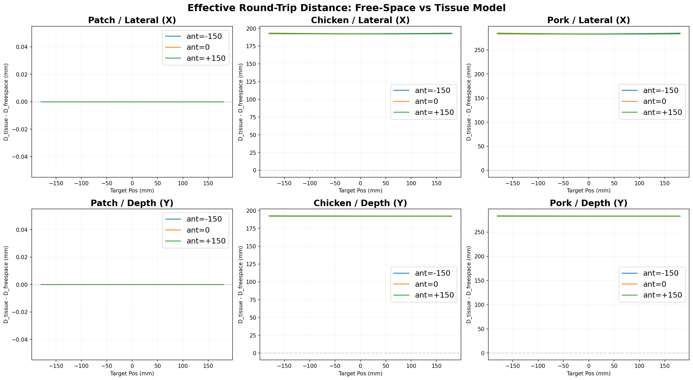

The tissue model adds a constant (position-independent) path-length offset (~190 mm for Chicken, ~280 mm for Pork).

### Phase Correction Magnitude

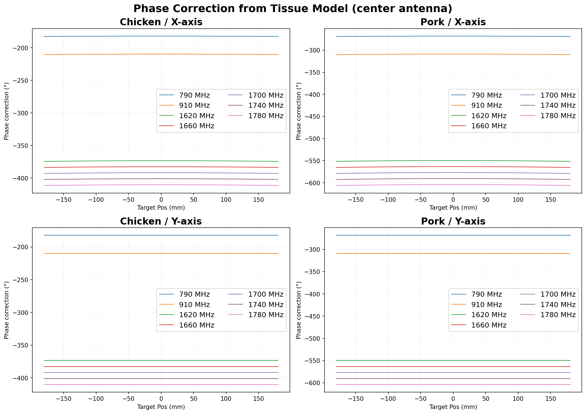

The tissue correction produces a phase shift of 200-600 deg that is flat across all target positions. Since our calibration algorithm computes differential phase (target vs. calibration reference), this constant offset cancels exactly.

### Performance With vs. Without Tissue Model

| Condition | With Tissue Model | Free-Space Only | Difference |
|-----------|:-----------------:|:---------------:|:---:|
| Patch/X | 21.6 mm | 21.6 mm | 0.0 mm |
| Chicken/X | 45.2 mm | 44.8 mm | 0.5 mm |
| Pork/X | 89.9 mm | 91.0 mm | 1.1 mm |
| Patch/Y | 14.6 mm | 14.6 mm | 0.0 mm |
| Chicken/Y | 144.8 mm | 144.8 mm | 0.0 mm |
| Pork/Y | 115.8 mm | 115.8 mm | 0.0 mm |

The tissue model has no measurable effect on localization accuracy. 5 out of 6 conditions show exactly 0.0 mm difference. This is because calibration subtraction inherently absorbs the constant tissue-induced phase delay. The tissue model would only matter if the correction were significantly angle-dependent across the scan range, but at these distances the angular variation is negligible.

### Measured vs. Model Phase Comparison

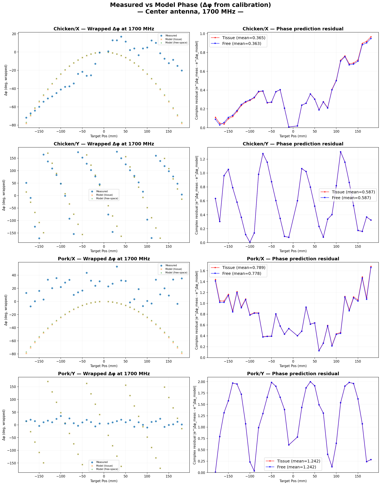

---

## 8. Experiment 6: Algorithmic Improvements

**Goal:** Test two algorithmic improvements to address Y-axis mirror ambiguity and overall robustness.

### 8.1 Per-Antenna Voting

At the true target position, all 5 antennas produce low phase residuals. At a ghost/mirror position, some antennas match while others do not. We score candidates by per-antenna consistency (penalizing high variance across antennas).

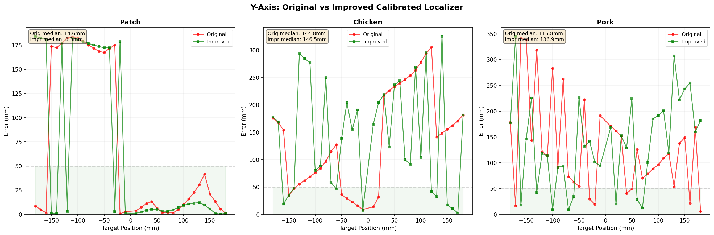

| Condition | Original Calibrated | + Per-Antenna Voting | Change |
|-----------|:---:|:---:|:---:|
| Patch/X | 21.6 mm | 24.7 mm | +3.1 mm |
| Chicken/X | 45.2 mm | 33.8 mm | -11.5 mm |
| Pork/X | 89.9 mm | 105.4 mm | +15.5 mm |
| Patch/Y | 14.6 mm | 8.3 mm | -6.4 mm |
| Chicken/Y | 144.8 mm | 146.5 mm | +1.7 mm |
| Pork/Y | 115.8 mm | 136.9 mm | +21.1 mm |

Per-antenna voting improves accuracy where there is sufficient signal (Patch/Y: 14.6 to 8.3 mm, Chicken/X: 45.2 to 33.8 mm). It regresses on Pork because with noise-dominated signals, per-antenna variance is random and the penalty adds confusion.

### 8.2 Ensemble of Top-5 Frequency Pairs

Instead of using a single frequency pair, the harmonic combination algorithm is run with the 5 best-performing pairs (identified in Experiment 2), and the median of the 5 estimates is taken.

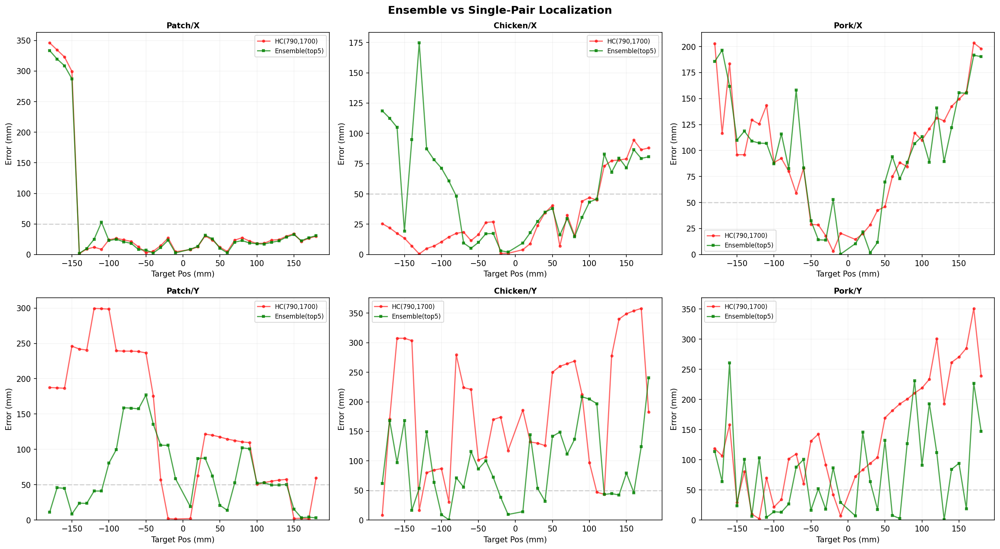

| Condition | HC Single Pair | Ensemble (median of top-5) | Change |
|-----------|:---:|:---:|:---:|
| Patch/X | 22.8 mm | 21.8 mm | -1.0 mm |
| Chicken/X | 20.2 mm | 23.0 mm | +2.8 mm |
| Pork/X | 94.2 mm | 96.0 mm | +1.8 mm |
| Patch/Y | 116.0 mm | 58.0 mm | -58.0 mm |
| Chicken/Y | 178.2 mm | 76.8 mm | -101.4 mm |
| Pork/Y | 114.0 mm | 67.0 mm | -47.0 mm |

The ensemble approach provides large Y-axis improvements across all conditions. The median filters out estimates from pairs that wrap to ghost positions. X-axis performance is essentially unchanged, indicating the ensemble primarily addresses phase-ambiguity without introducing new biases.

---

## 9. Summary

### Best Results Per Condition

| Condition | HC Original | Calibrated | Cal + Voting | Ensemble (5) | Best |
|-----------|:---:|:---:|:---:|:---:|:---:|
| Patch/X | 22.8 | 21.6 | 24.7 | 21.8 | **21.6 mm** (Calibrated) |
| Chicken/X | 20.2 | 45.2 | 33.8 | 23.0 | **20.2 mm** (HC) |
| Pork/X | 94.2 | 89.9 | 105.4 | 96.0 | **89.9 mm** (Calibrated) |
| Patch/Y | 116.0 | 14.6 | 8.3 | 58.0 | **8.3 mm** (Cal + Voting) |
| Chicken/Y | 178.2 | 144.8 | 146.5 | 76.8 | **76.8 mm** (Ensemble) |
| Pork/Y | 114.0 | 115.8 | 136.9 | 67.0 | **67.0 mm** (Ensemble) |

### Key Findings

1. **Signal attenuation is the primary bottleneck for tissue-covered conditions.** Pork measurements are at the noise floor (-119 dBm, phase std > 104 deg). Algorithmic improvements cannot extract position information from random phase values.

2. **Free-space localization is feasible.** Patch achieves 21.6 mm lateral and 8.3 mm depth accuracy.

3. **Chicken shows partial signal viability.** The 1700 MHz harmonic retains coherence through chicken tissue, enabling 20.2 mm lateral accuracy. Most other harmonics are noise-dominated.

4. **The tissue model is ineffective.** Calibration subtraction inherently cancels the constant tissue-induced delay. The Snell's-law refraction model adds no measurable benefit.

5. **Frequency pair selection has a significant impact.** The original paper's pair (790, 1700 MHz) is suboptimal in 5 out of 6 conditions. Selecting the best pair per condition can reduce Y-axis error by over 50%.

6. **Ensemble localization reduces Y-axis errors.** Taking the median of estimates from 5 frequency pairs filters out phase-ambiguity outliers, cutting Chicken/Y error from 178 mm to 77 mm.
